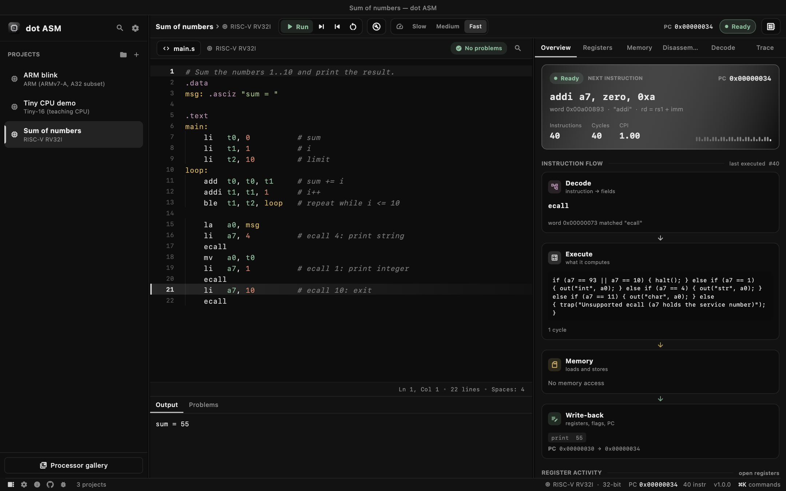
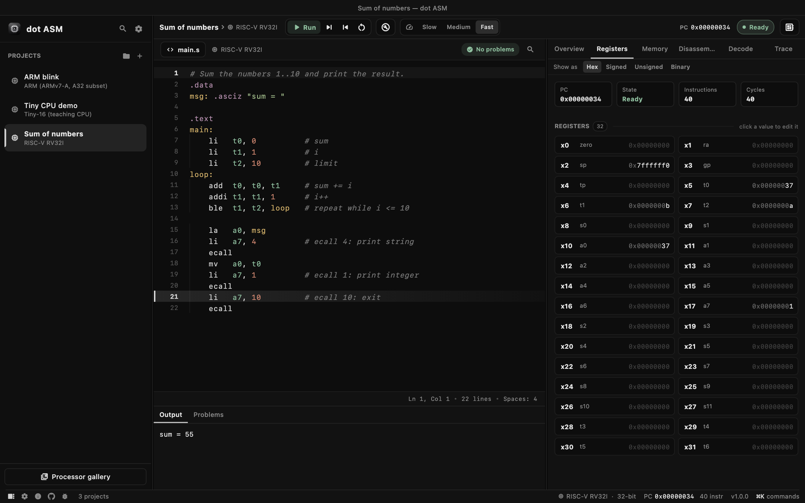
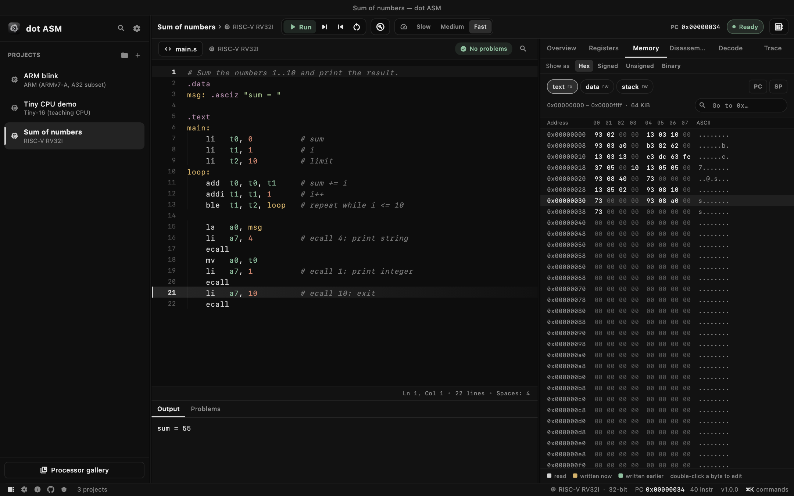
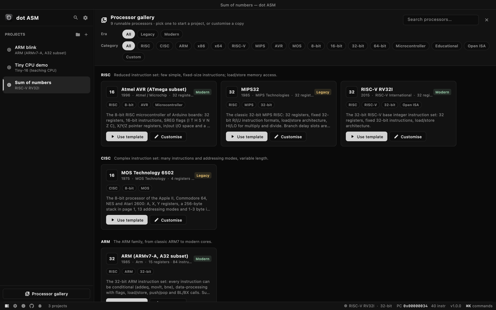
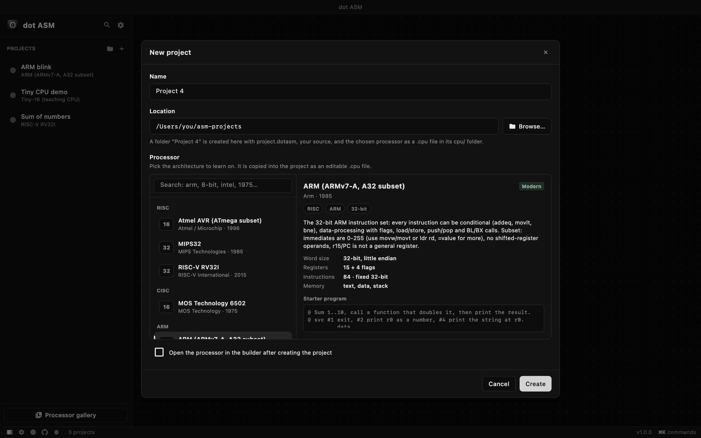
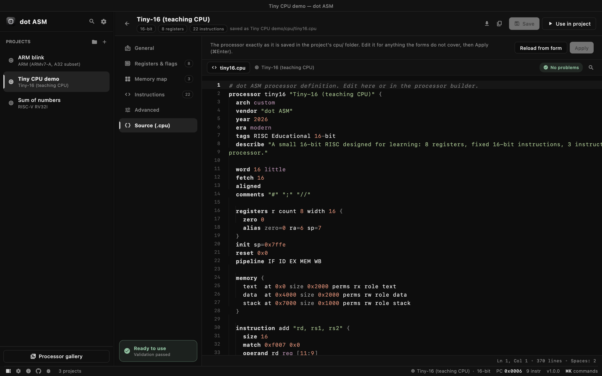
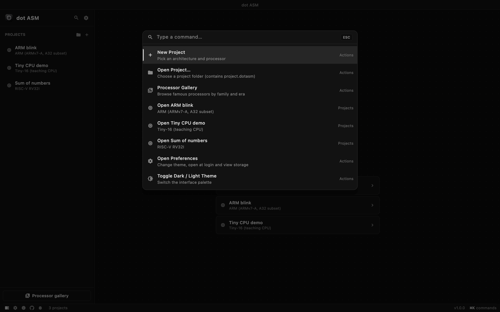
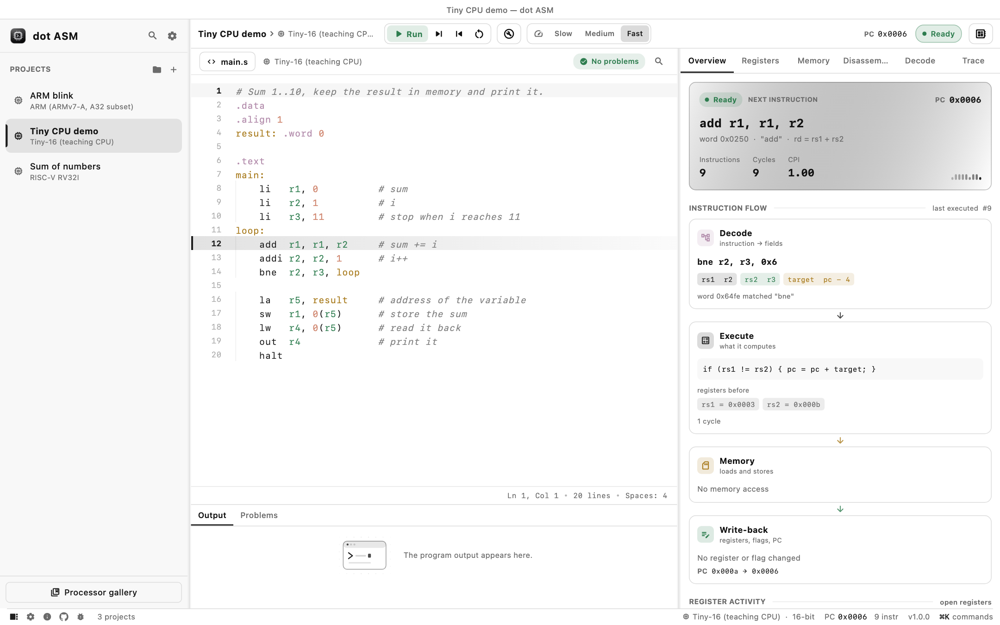

<h1 align="center">dot ASM</h1>

<p align="center">
  Learn assembly and understand processors from the inside.<br>
  Write assembly, run it on a simulated CPU, and watch registers, flags, memory and the decoded instruction change as you step.<br>
  Pick a processor from the gallery or design your own. Runs natively on macOS, Windows and Linux.
</p>

<p align="center">
  <strong>Native Desktop</strong> • <strong>Real Processors</strong> • <strong>Design Your Own CPU</strong> • <strong>Offline First</strong>
</p>

<p align="center">
  
</p>

---

## App details

| Property | Details |
|---|---|
| **Platforms** | macOS 12+ (Apple Silicon and Intel), Windows 10/11 (x64), Linux (x86_64) |
| **Technology** | Flutter desktop app, no Electron |
| **Data and privacy** | 100% offline and local: no account, no cloud, no telemetry. The only network use is the optional check for a newer release on GitHub |
| **Application ID** | `io.github.prateekthakur272.dotasm` |

---

## Why dot ASM

- **See what the processor does.** Step through a program and watch the instruction decode, the registers change, memory
  being read and written, and the flags flip. Step back to undo it.
- **Real architectures.** RISC-V, MIPS, ARM, x86, x86-64, the MOS 6502 and Atmel AVR, with real instruction encodings.
- **Nothing is hidden.** Every processor is a readable text file in your project. Open it, change an instruction, and see
  the effect on your program.
- **Design your own CPU.** The processor builder edits the word size, registers, flags, memory map, instruction
  encodings and what each instruction does, and validates it as you type.
- **Real code editors.** Syntax highlighting, suggestions, error marks, find and replace, for your assembly and for the
  processor files.
- **Your files, your folders.** A project is a folder you choose. No import, no database, easy to keep in git.

---

## Features at a glance

| Area | Capabilities |
|---|---|
| **Run and debug** | Run, pause, step, **step back** (exact undo of registers, flags, memory and output), breakpoints, run to here, set the PC, edit registers, flags and memory by hand, run speed |
| **Processor view** | Overview dashboard (next instruction, instruction flow through decode / execute / memory / write-back, register activity), registers and flags, memory hex dump, disassembly, instruction decode with coloured bits, a trace you can rewind through |
| **Processor gallery** | RISC-V RV32I, MIPS32, ARM (A32), x86, x86-64, MOS 6502, Atmel AVR, the Tiny-16 teaching CPU and a blank one; grouped by RISC, CISC, ARM and x86/x64, filtered by era (legacy / modern), tags and search |
| **Processor builder** | Forms for identity, registers and flags, memory map, instruction encodings and semantics; a `.cpu` source editor with suggestions and live error marking; a starter-program editor; import and export |
| **Assembly editor** | Highlighting for the processor's own instructions and registers, suggestions with syntax help, auto-indent, brackets and quotes, bracket matching, indent guides, error underlines, find and replace, line commands |
| **Projects** | Folders you choose with `project.dotasm`, your source and a `cpu/` folder; recent projects on the start screen |
| **Command palette** | `⌘K` / `Ctrl+K` for everything: projects, running, tabs, gallery, builder, theme |
| **Desktop polish** | Black and grey dark and light themes, native window chrome on each platform, remembered window position, update checks |

## Screenshots

| | |
|---|---|
|  |  |
| **Registers**: edit values, pin, follow pointers | **Memory**: hex dump with reads and writes marked |
|  |  |
| **Processor gallery** by family and era | **New project** with the processor picker |
|  |  |
| **Processor builder**: the `.cpu` source in a code editor | **Command palette** |


*The light theme.*

## Install

Download the installer for your platform from the [latest release](../../releases/latest):

| System | Files | How |
|---|---|---|
| **macOS** (Apple silicon and Intel) | `.dmg`, `.pkg` | Open the DMG and drag **dot ASM** to Applications |
| **Windows** | `.exe` (setup), `.msix` | Run the setup program |
| **Linux** | `.deb`, `.rpm`, `.AppImage` | `sudo apt install ./<file>.deb`, `sudo dnf install ./<file>.rpm`, or `chmod +x` the AppImage and run it |

The installers are currently unsigned. On macOS, right-click the app and choose **Open** the first time; Windows may show
a SmartScreen warning.

## Build from source

```bash
flutter pub get
flutter run -d macos        # or -d windows, -d linux
flutter analyze && flutter test
```

## Documentation

| Guide | What it covers |
|---|---|
| [Getting started](docs/getting-started.md) | Install, create a project and run your first program |
| [User manual](docs/user-manual.md) | Everything in the app, step by step |
| [Features](docs/features.md) | A tour of the capabilities |
| [Keyboard shortcuts](docs/keyboard-shortcuts.md) | App, running and editor shortcuts |
| [Processor files](docs/PROCESSORS.md) | The `.cpu` and `project.dotasm` formats, and how to add a processor |
| [Troubleshooting](docs/troubleshooting.md) | Common problems and where the files are |
| [Architecture](docs/ARCHITECTURE.md) | How the app and the simulator are built |
| [Project structure](docs/project-structure.md) | Folders and what is in them |
| [Building and releasing](docs/building-and-releasing.md) | Installers, releases and the marketplace listing |
| [Contributing](docs/contributing.md) | Development setup and guidelines |

Architecture rules are in [AGENTS.md](AGENTS.md). The name, links and repository URL are set in `lib/utils/app_config.dart`.
