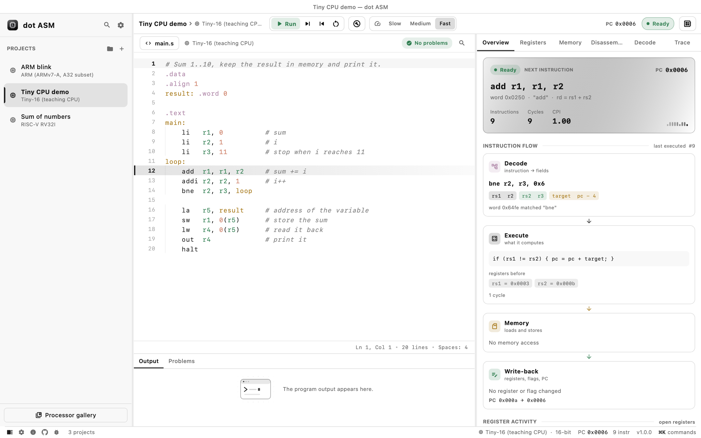

# Features

## Learn assembly by watching the processor

- **Run, pause, step, step back.** Execute a program instruction by instruction and undo steps exactly: registers,
  flags, memory and output are restored.
- **Breakpoints and run to here.** Stop at a line, or run to any address from the disassembly.
- **Live internals.** Registers and flags with the change from the last step highlighted; a memory hex dump that marks
  reads and writes; the disassembly with the program counter followed; the decoded instruction bits coloured by operand;
  a full trace you can rewind through.
- **Overview dashboard.** The next instruction, how the previous one moved through decode, execute, memory and
  write-back, cycle counts and a map of register activity.
- **Debugger edits.** Change a register, flag, the PC or a memory byte by hand and carry on.
- **Clear errors.** The assembler reports the line and the problem and shows it in the editor. Mistakes in a processor
  file are reported with their line too, and a misspelled statement comes with a suggestion.

## Many architectures, all from plain files

| | |
|---|---|
| **RISC** | RISC-V RV32I, MIPS32, Atmel AVR |
| **CISC** | MOS 6502, Intel x86 (IA-32) |
| **ARM** | ARMv7-A (A32) with conditional execution |
| **x64** | x86-64 (AMD64) |
| **Educational** | Tiny-16, and a blank processor |

Era filters (legacy, modern), family tags and search organise the [processor gallery](user-manual.md#the-processor-gallery).
The app contains **no processor in code**: each one is a `.cpu` text file that it reads to build the registers, the memory,
the assembler, the decoder and the simulator. See [PROCESSORS.md](PROCESSORS.md).

## Design your own processor

The [processor builder](user-manual.md#the-processor-builder) edits every part of a processor: word size and byte order,
register file, flags, memory map, instruction encodings (mask, value and operand fields) and what each instruction does,
written in a small expression language with no loops or I/O, so opening someone else's processor never runs arbitrary
code. Changes are validated as you type, and the result is a readable `.cpu` file in your project that you can share.

## Two real code editors

- **Assembly editor.** Highlighting for the processor's instructions, registers and labels; suggestions with the
  instruction's syntax and description; auto-indent; auto-closing brackets and quotes; bracket matching; indent
  guides; error underlines with the message after the line; find and replace; line commands.
- **Processor source editor.** The same editor for `.cpu` files, with keyword suggestions, brace-aware indentation, live
  parse errors and the starter program as a third instance.

## Projects that are just folders

A project is a folder with `project.dotasm`, your source and a `cpu/` folder. Keep them in git, move them, share them.
The app remembers where they are and lists the most recent on the start screen.

## Desktop polish

- A black and grey theme in dark and light, following the system by default.
- A command palette (`⌘K` / `Ctrl+K`) and platform-aware shortcuts.
- A native look on macOS (traffic lights, system menu bar) and an in-window menu with window buttons on Windows and Linux.
- Window position and sidebar width are remembered, and the window only appears once it is ready.
- Update checks against GitHub releases, with a status-bar badge.
- Fully offline: no account, no cloud, no telemetry.

