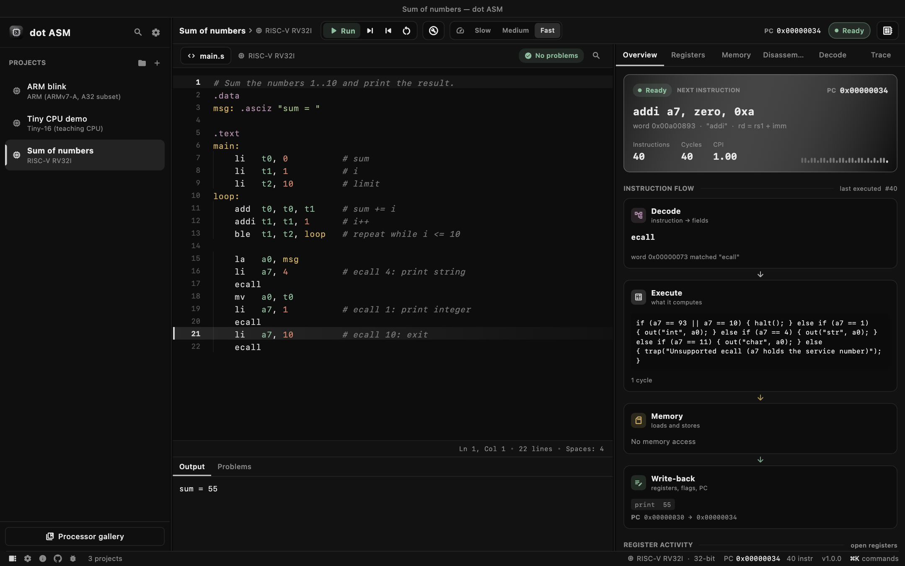

# Getting started

## Install

Download the installer for your system from the [latest release](../../../releases/latest).

| System | Files | How |
|---|---|---|
| **macOS** (Apple silicon and Intel) | `.dmg`, `.pkg` | Open the DMG and drag **dot ASM** to Applications |
| **Windows** | `.exe`, `.msix` | Run the setup program |
| **Linux** | `.deb`, `.rpm`, `.AppImage` | `sudo apt install ./<file>.deb`, `sudo dnf install ./<file>.rpm`, or make the AppImage executable and run it |

The installers are currently unsigned. On macOS, right-click the app and choose **Open** the first time; Windows may
show a SmartScreen warning.

To build from source instead, see [building and releasing](building-and-releasing.md).

## First run

The first time you start dot ASM, a short **welcome tour** explains what the app does, how projects work, what to watch while
a program runs, and how to get started. It ends with buttons to create a project, browse the processor gallery or open
an existing project. Open it again any time from **Help ▸ Welcome Tour…** or the command palette (`⌘K`).

## Your first program

1. Click **New project** (`⌘N` / `Ctrl+N`) in the sidebar or on the start screen.
2. Give the project a **name**, choose the **location** (a folder on your computer; the project gets its own folder
   there) and pick a **processor**. Search by name, family, size or year, and the right-hand side shows what the
   processor offers and its starter program. **RISC-V RV32I** and **Tiny-16** are good first choices.
3. Click **Create**. The project opens with a small starter program already in the editor.
4. Press **Run** (`F5`) to run it to the end, or **Step** (`F10`) to execute one instruction at a time.
5. Watch the panel on the right. The **Overview** shows the instruction about to run, how the last one flowed through
   decode, execute, memory and write-back, and which registers it touched.

## What you see

- **Sidebar**: your projects, the processor gallery, search (`⌘K`) and preferences.
- **Toolbar**: Run / Pause, Step, Step back, Reset, Assemble, the run speed, the live PC and the state of the processor.
- **Editor**: your assembly, with highlighting, suggestions, breakpoints (click the gutter) and error marks.
- **Output and Problems**: what the program prints, and what the assembler did not understand.
- **Processor panel**: Overview, Registers, Memory, Disassembly, Decode and Trace.

## Next steps

- Read the [user manual](user-manual.md) for the details of each part.
- Look through the [processor gallery](user-manual.md#the-processor-gallery) to try another architecture.
- Open the [processor builder](user-manual.md#the-processor-builder) and change how an instruction works.
- Learn the [keyboard shortcuts](keyboard-shortcuts.md).
