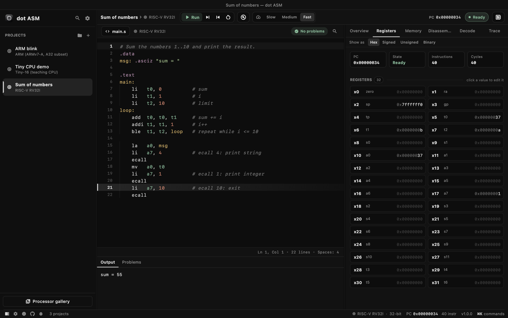
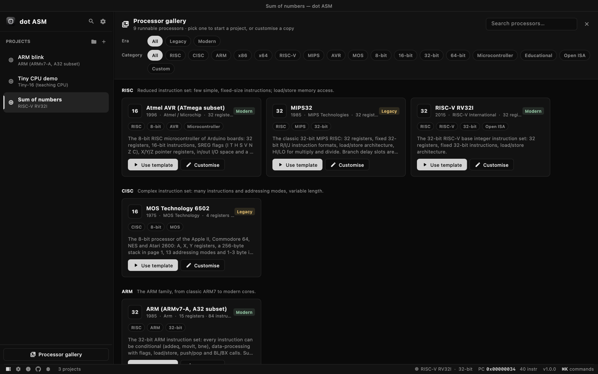
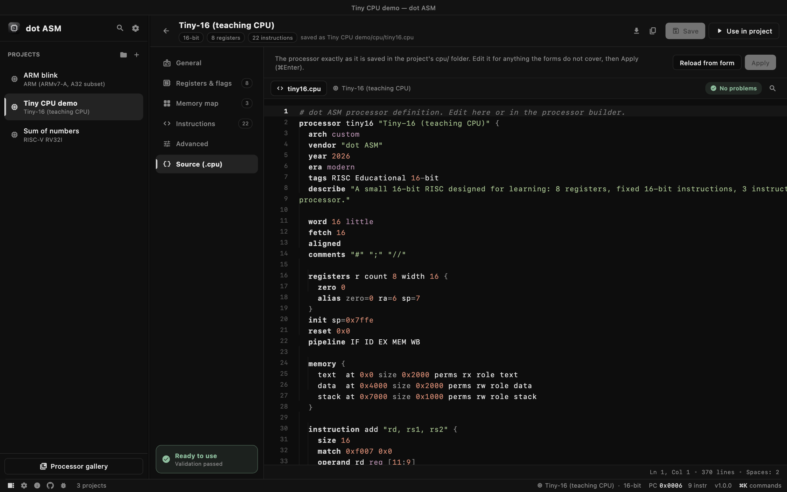
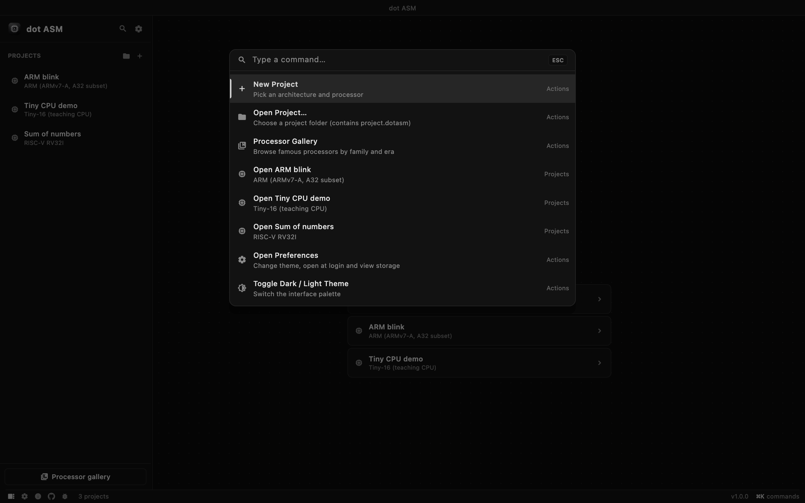

# User manual

## Projects

A project is a **folder you choose**. It holds three things:

```
MyProject/
  project.dotasm     the project's settings
  main.s             your assembly
  cpu/
    rv32i.cpu        the processor the project runs on (you can have several)
```

- **New project**: pick a name, a location and a processor. The chosen processor is *copied* into the project's `cpu/`
  folder, so the project owns it and you can change it freely.
- **Open project…**: choose any folder that contains a `project.dotasm`. Projects open from anywhere; the app only
  remembers where they are.
- **Right-click a project** in the sidebar to show it in your file manager, copy its folder path, rename it, or remove it
  from the list (the removal dialog also offers to delete the folder).
- The start screen lists your **recent projects**, most recently opened first.

Everything is saved as you work. The source is written a moment after you stop typing.

## Writing assembly

The editor understands the processor of the project: instructions, registers and aliases are coloured, labels are
collected from your code, and the status strip under the editor shows the syntax of the instruction on the current line.

- **Suggestions** appear as you type: instructions at the start of a line, registers and labels after it, directives
  after a dot. `Tab` or `Enter` accepts, `Esc` closes, `Ctrl+Space` forces them open.
- **Problems** the assembler finds are underlined in red with the message after the line, listed in the **Problems**
  tab, and counted in the header. Click the count to jump to the first one.
- **Breakpoints**: click the gutter beside a line. The program stops *before* that line when you press Run.
- **Find and replace** (`⌘F`), comment toggling, duplicating and moving lines: see the [shortcuts](keyboard-shortcuts.md).
- The program is assembled automatically after you stop typing. **Assemble** (the wrench button) does it on demand and
  resets the processor.

Each processor has its own syntax, comment characters and directives. The starter program of every processor is a
good reference. Common directives: `.text`, `.data`, `.org`, `.align`, `.equ`, `.byte`, `.half`, `.word`, `.ascii`,
`.asciz`, `.space`.

## Running

| Button | What it does |
|---|---|
| **Run** (`F5`) | Runs until the program halts, hits a breakpoint, faults, or you press **Pause** |
| **Step** (`F10`) | Executes the next instruction |
| **Step back** (`Shift+F10`) | Undoes the last instruction: registers, flags, memory and output |
| **Reset** | Clears the processor and reloads the program |
| **Assemble** | Re-reads your source, then resets |
| **Speed** | Slow, Medium or Fast: how quickly Run executes |

What the program prints appears in **Output**. A fault (for example a store to read-only memory or an unknown
instruction) stops the processor and is explained in the Overview and the Registers tab.

## The processor panel

**Overview** is the dashboard. At the top, the instruction about to run, with its encoding and description, and the
number of instructions, cycles and cycles per instruction. **Instruction flow** shows the last instruction passing
through *Decode* (its fields), *Execute* (what it computes and the register values from before it ran), *Memory*
(loads and stores) and *Write-back* (registers, flags and PC). **Register activity** is a map of every register:
written by the last instruction, written recently, read, or holding a value. Hover a tile for its value.

**Registers** shows every register and flag.
- Click a value to **edit it** (hex `0x1f` or `$1f`, binary `0b101`, decimal, negatives). Enter confirms, Esc cancels.
- Click a **flag** to toggle it, or the **PC** box to set the program counter.
- The star **pins** a register to a *Watch* section at the top. The chip icon on a register that points into memory
  opens the Memory tab there.
- Use **Show as** to switch between hex, signed, unsigned and binary.

**Memory** is a hex dump of the processor's memory regions.
- Switch regions with the pills, jump to **PC** or **SP**, or type an address into **Go to**.
- Click a byte to see it as 8, 16 and 32-bit numbers; double-click to edit it.
- Bytes read by the last instruction, written by it, or written earlier are marked.

**Disassembly** lists the assembled program. The next instruction is highlighted and kept in view. Click a row to toggle
a breakpoint; hover for **Run to here** and **Set PC here**.

**Decode** takes the next instruction apart: its bits coloured by operand, the matched encoding, each operand's value,
and the semantics.

**Trace** records every executed instruction with the registers, flags and memory it changed. Click an older entry to
**rewind** to just after it.

Edits made by hand (registers, flags, PC, memory) are not part of the step history, so **Step back** does not undo them.



## The processor gallery

Open it from the sidebar. Processors are grouped by family (RISC, CISC, ARM, x86/x64, educational) and can be filtered
by **era** (legacy or modern), by tags and by search.

| Processor | Notes |
|---|---|
| RISC-V RV32I | The 32-bit base integer instruction set |
| MIPS32 | The classic teaching RISC |
| ARM (ARMv7-A, A32 subset) | Conditional execution on every instruction |
| Intel x86 (IA-32 subset) | Variable-length instructions, ModRM and SIB addressing |
| x86-64 (AMD64 subset) | The 64-bit extension |
| MOS Technology 6502 | The 8-bit CPU of the Apple II, Commodore 64 and NES |
| Atmel AVR (ATmega subset) | The 8-bit RISC microcontroller of Arduino boards |
| Tiny-16 | A small 16-bit teaching CPU, a good base for your own |
| Blank processor | The starting point for designing your own |

Each card offers **Use template** (start a new project with it) and **Customise** (a copy you can edit). Processors that
are planned but not yet simulated are shown too, marked as such.



## The processor builder

Open it from the toolbar while a project is open. It edits the project's current processor.

- **General**: name, id, family, word size, byte order, default instruction size and alignment.
- **Registers & flags**: a register file (prefix, count, width, zero register, alternative names), extra named
  registers and flags.
- **Memory map**: regions with their permissions and what each one is for.
- **Instructions**: for each instruction its mnemonic and syntax, which bits identify it (mask and value), where each
  operand sits in the word, and what it does. A strip shows the whole word with the operands coloured.
- **Advanced**: the reset state, assembler and pipeline settings, and the **starter program** that new projects begin
  with, edited in a code editor with suggestions for this processor's own instructions.
- **Source (.cpu)**: the same processor as text, in a code editor with highlighting, keyword suggestions, brace-aware
  indentation and live error marking. Edit it for anything the forms do not cover, then **Apply**.

The navigation shows whether the processor is **Ready to use** or lists its problems. **Save** writes
`cpu/<id>.cpu`; **Use in project** saves and makes it the project's processor. The icons beside Save export the file or
copy its source. The file format is described in [PROCESSORS.md](PROCESSORS.md).



## Command palette

`⌘K` / `Ctrl+K` opens a search over everything you can do: create or open a project, run, step, assemble, switch tabs,
open the gallery or the builder, change the theme. Type a few letters and press Enter.



## Preferences and updates

Open **Preferences** (`⌘,` / `Ctrl+,`) to choose the theme (system, dark or light) and whether the app opens at login.
The app checks GitHub for a newer release shortly after it starts and shows a badge in the status bar when there is one.
**Check for Updates…** in the menu does it on demand. Nothing else is ever sent anywhere.

The bottom status bar has quick buttons for the sidebar, preferences, About, the developer's links (right-click for more)
and *Report an issue*, plus the open processor, the live PC and the app version.

## Where your data is

| What | Where |
|---|---|
| Your projects | The folders you chose |
| App settings, window position, the list of projects | `~/.dotasm` (use **Show Data Folder** in the menu) |
| Log file | `~/.dotasm/dotasm.log` |

Deleting `~/.dotasm` resets the app's settings and forgets where your projects are, but does not touch the projects.
